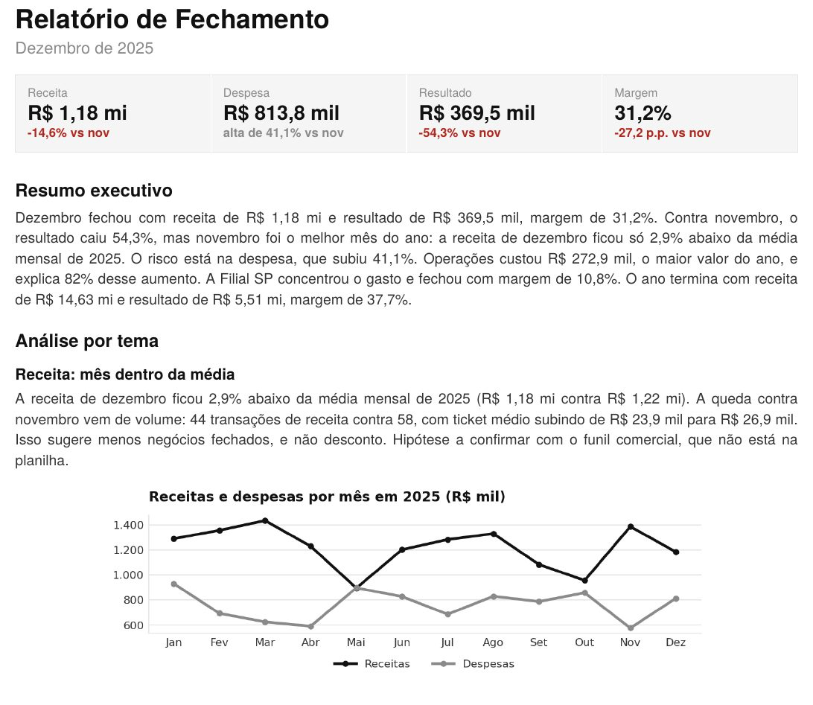

# Dashboards e soluções de BI

Galeria dos meus dashboards em **Power BI** e **Tableau** e de soluções de dados construídas com **IA generativa**. Cada item tem um print e o link para a versão interativa, quando ela é pública.

Todos os projetos usam dados fictícios, públicos ou de treinamento. Nenhum dado de empresa.

**Navegue por:** [Power BI](#power-bi) · [Tableau](#tableau) · [Soluções com IA generativa](#soluções-com-ia-generativa)

---

## Power BI

### Dashboard de campanhas de marketing
Painel de performance de mídia paga em Facebook, Instagram, Google e LinkedIn.
- Investimento, receita, ROI, CTR, CPC e CPA
- ROI e investimento por plataforma, conversões por região
- Evolução de investimento e receita, com filtros por campanha e período

🔗 [Abrir o dashboard interativo](https://app.powerbi.com/view?r=eyJrIjoiN2E2MTVhZGYtNzYxNi00ZDhiLWIyN2EtMTM2ZTQ4YTk5ZGEwIiwidCI6IjU4NTQwODYwLTQzNDgtNDQwMC05NjI3LTlmMTA4MWNiYWFjMiJ9)

### Dashboard de e-commerce
Painel de vendas de uma loja online de calçados, bolsas e acessórios.
- Faturamento mês a mês, pedidos, clientes e itens vendidos
- Ranking de produtos por categoria com barras de valor
- Vendas por canal: site e aplicativo

🔗 [Abrir o dashboard interativo](https://app.powerbi.com/view?r=eyJrIjoiMTJlYjVkYzMtMWEwMy00ZWMyLTkzNDgtOTJkMWVkNGZlM2NkIiwidCI6IjU4NTQwODYwLTQzNDgtNDQwMC05NjI3LTlmMTA4MWNiYWFjMiJ9)

### Documentação de modelo Power BI (NPS)
Documentação técnica gerada a partir do modelo de dados aberto no Power BI Desktop.
- Arquitetura, dicionário de dados e relacionamentos
- Catálogo de 29 medidas DAX organizadas em pastas
- Margem de erro do NPS por segmento

🔗 [Abrir a documentação](https://claude.ai/artifact/UVRvVbMoNKXaaxQhTPXkLw)

---

## Tableau

### Vendas e lucro por categoria, subcategoria e produto
Painel com a base pública *Superstore*.

🔗 [Abrir no Tableau Public](https://public.tableau.com/views/DashboardSuperstorebyCategory/DashSalesandProfitsbyCategorySub-CategoryandProduct)

### KPIs de acompanhamento
Painel de KPIs desenvolvido como case de teste técnico: migração de clientes entre clusters, clientes em queda e tendências mensais.

🔗 [Abrir no Tableau Public](https://public.tableau.com/views/KPIdeAcompanhamento/KPIdeAcompanhamento)

---

## Soluções com IA generativa

### Fluxo de Caixa 2025 · Claude + Vercel
Dashboard financeiro publicado na web, a partir de um extrato com 1.200 lançamentos.
- Receitas, despesas, lucro e margem com filtros por período
- Mapa de calor de despesas por categoria e mês
- Auditoria da base, separando evidência de hipótese

🔗 [Abrir o dashboard](https://fluxo-de-caixa-2025-two.vercel.app/)

### RotaViva: painel de logística · Claude + Lovable
Painel de entregas com camada de acesso por login, pensado para uso interno de uma operação.
- Entregas no prazo, atrasos, custo de frete e ocorrências
- Visões por transportadora, rota e região
- Destaques automáticos: onde agir primeiro

> O acesso exige login. Acesso de demonstração sob pedido.

### Análise de satisfação NPS · Claude + Figma
Apresentação executiva gerada a partir de um dashboard, com a análise transformada em narrativa.
- Sumário executivo com NPS, promotores e detratores
- Destaques por região, gerente e comentários

🔗 [Ver a apresentação](https://www.figma.com/deck/sUV5QB78OCeCFdWgE6lmWP/)

### Relatório de fechamento automatizado · Claude (skill personalizada)
Uma skill que recebe a planilha do mês e gera o relatório de fechamento em PDF.
- KPIs com variação contra o mês anterior
- Resumo executivo e análise por tema
- Gráficos e hipóteses separadas dos fatos

---

**Jéssica Priscila de Oliveira Martins** · [LinkedIn](https://www.linkedin.com/in/jessica-oliveira-martins/) · [Portfólio](https://claude.ai/artifact/YPyaaqo16QuwKBKGw9VF5m) · [Outros projetos](https://github.com/jessicapmartins)
