# Dashboards e soluções de BI

Galeria dos meus dashboards em **Power BI** e **Tableau** e de soluções de dados construídas com **IA generativa**. Cada item tem um print e o link para a versão interativa, quando ela é pública.

Todos os projetos usam dados fictícios, públicos ou de treinamento. Nenhum dado de empresa.

**Navegue por:** [Power BI](#power-bi) · [Tableau](#tableau) · [Soluções com IA generativa](#soluções-com-ia-generativa)

---

## Power BI

### Faltas em consultas · risco e próxima melhor ação
**Autoral.** painel de 4 páginas sobre 110 mil consultas da rede pública de Vitória (ES), ligado a um modelo de risco de falta ([código](https://github.com/jessicapmartins/previsao-faltas-consultas)).
- Visão geral com taxa de falta por dia, antecedência, histórico e idade
- O paradoxo do SMS: por que o efeito não pode ser medido com esta base
- Agenda da semana com a ação recomendada para cada consulta e a economia esperada

[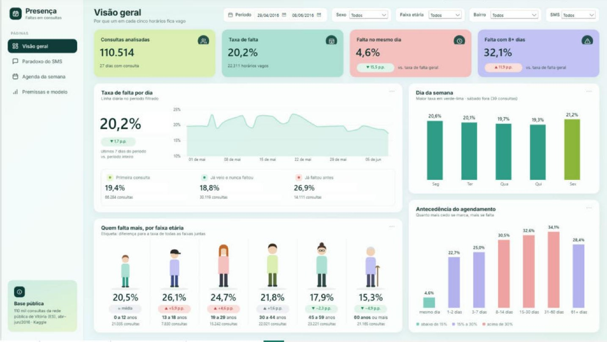](https://app.powerbi.com/view?r=eyJrIjoiODA0MjQyYzYtNTMwOC00ZGM0LTgxYjUtOTMyMzY2ZjBhNjYzIiwidCI6IjU4NTQwODYwLTQzNDgtNDQwMC05NjI3LTlmMTA4MWNiYWFjMiJ9)

🔗 [Abrir o dashboard interativo](https://app.powerbi.com/view?r=eyJrIjoiODA0MjQyYzYtNTMwOC00ZGM0LTgxYjUtOTMyMzY2ZjBhNjYzIiwidCI6IjU4NTQwODYwLTQzNDgtNDQwMC05NjI3LTlmMTA4MWNiYWFjMiJ9)

### Dashboard de campanhas de marketing
*Recriado a partir de tutorial.* Painel de performance de mídia paga em Facebook, Instagram, Google e LinkedIn.
- Investimento, receita, ROI, CTR, CPC e CPA
- ROI e investimento por plataforma, conversões por região
- Evolução de investimento e receita, com filtros por campanha e período

[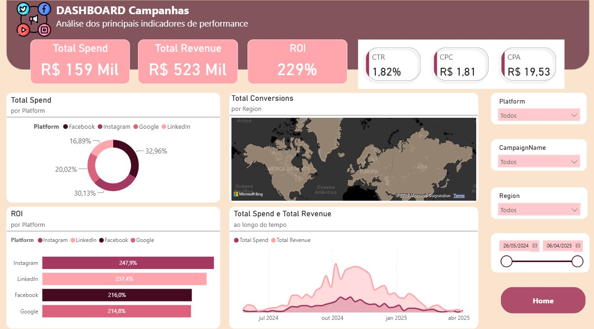](https://app.powerbi.com/view?r=eyJrIjoiN2E2MTVhZGYtNzYxNi00ZDhiLWIyN2EtMTM2ZTQ4YTk5ZGEwIiwidCI6IjU4NTQwODYwLTQzNDgtNDQwMC05NjI3LTlmMTA4MWNiYWFjMiJ9)

🔗 [Abrir o dashboard interativo](https://app.powerbi.com/view?r=eyJrIjoiN2E2MTVhZGYtNzYxNi00ZDhiLWIyN2EtMTM2ZTQ4YTk5ZGEwIiwidCI6IjU4NTQwODYwLTQzNDgtNDQwMC05NjI3LTlmMTA4MWNiYWFjMiJ9)

### Dashboard de e-commerce
*Recriado a partir de tutorial.* Painel de vendas de uma loja online de calçados, bolsas e acessórios.
- Faturamento mês a mês, pedidos, clientes e itens vendidos
- Ranking de produtos por categoria com barras de valor
- Vendas por canal: site e aplicativo

[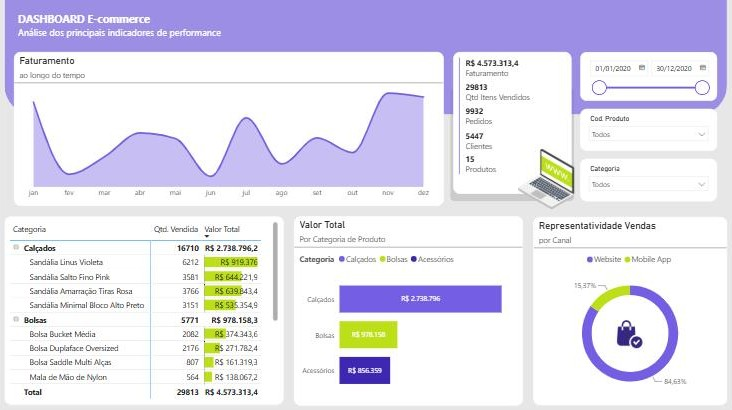](https://app.powerbi.com/view?r=eyJrIjoiMTJlYjVkYzMtMWEwMy00ZWMyLTkzNDgtOTJkMWVkNGZlM2NkIiwidCI6IjU4NTQwODYwLTQzNDgtNDQwMC05NjI3LTlmMTA4MWNiYWFjMiJ9)

🔗 [Abrir o dashboard interativo](https://app.powerbi.com/view?r=eyJrIjoiMTJlYjVkYzMtMWEwMy00ZWMyLTkzNDgtOTJkMWVkNGZlM2NkIiwidCI6IjU4NTQwODYwLTQzNDgtNDQwMC05NjI3LTlmMTA4MWNiYWFjMiJ9)

### Documentação de modelo Power BI (NPS)
Documentação técnica gerada a partir do modelo de dados aberto no Power BI Desktop.
- Arquitetura, dicionário de dados e relacionamentos
- Catálogo de 29 medidas DAX organizadas em pastas
- Margem de erro do NPS por segmento

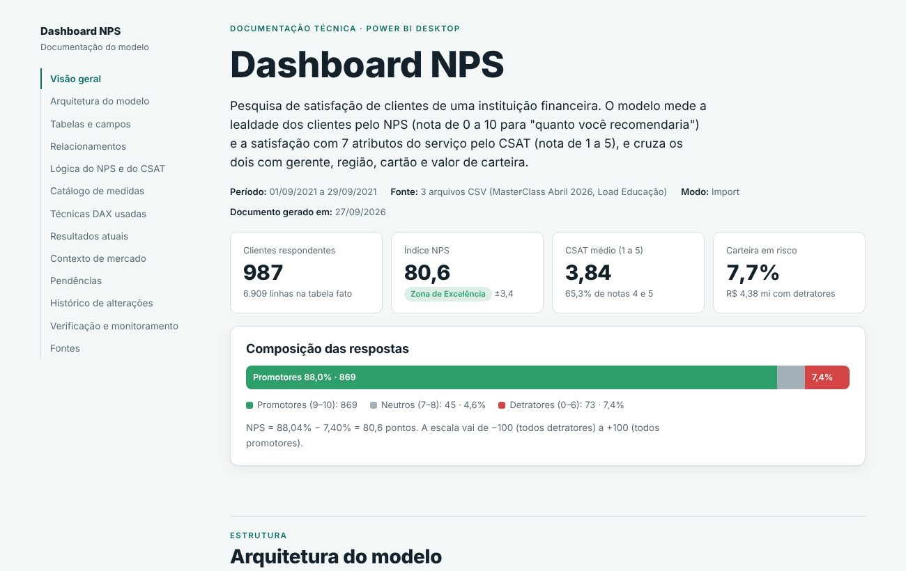

🔗 [Abrir a documentação](https://claude.ai/artifact/UVRvVbMoNKXaaxQhTPXkLw)

---

## Tableau

### Segmentação de clientes de e-commerce (Olist)
**Autoral.** Painel final do projeto [segmentacao-clientes-olist](https://github.com/jessicapmartins/segmentacao-clientes-olist), com 93 mil clientes reais e anonimizados da Olist segmentados por RFM + K-Means.
- Cartões de KPI: clientes, receita, valor médio, taxa de recompra e nota média
- Participação de cada segmento em clientes e em receita, mapa por estado e receita mensal por segmento
- Ação de CRM recomendada por segmento, com filtros de segmento e estado

🔗 [Abrir no Tableau Public](https://public.tableau.com/views/Dash-Olist/PainelOlist-Segmentaodeclientes)

### Vendas e lucro por categoria, subcategoria e produto
*Recriado a partir de tutorial.* Painel com a base pública *Superstore*.

🔗 [Abrir no Tableau Public](https://public.tableau.com/views/DashboardSuperstorebyCategory/DashSalesandProfitsbyCategorySub-CategoryandProduct)

---

## Soluções com IA generativa

### Clínicas Aurora · fluxo de caixa · Claude + Chart.js + Vercel
**Autoral, dados sintéticos.** Painel de uma rede fictícia de três clínicas, com o custo das faltas calibrado pela base real do projeto [previsão de faltas](https://github.com/jessicapmartins/previsao-faltas-consultas). Publicado na Vercel ([código](fluxo-caixa-clinicas)).
- Receita, despesas, resultado e DRE simplificada por unidade e período
- Receita e margem perdidas com faltas, por mês, especialidade e dia da semana
- Simulador de cenários: quanto vale reduzir as faltas, descontado o custo dos contatos

[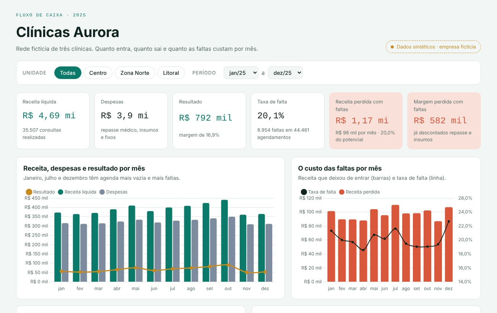](https://clinicas-aurora.vercel.app/)

🔗 [Abrir o dashboard](https://clinicas-aurora.vercel.app/)

### Apresentação executiva · faltas em consultas · Claude + Figma Slides
**Autoral.** Deck gerado a partir do painel de faltas: do tamanho do problema à ação recomendada para cada consulta, com notas do apresentador.
- Antecedência, perfil do paciente e o paradoxo do SMS
- Modelo de risco e regra de próxima melhor ação, com próximos passos

[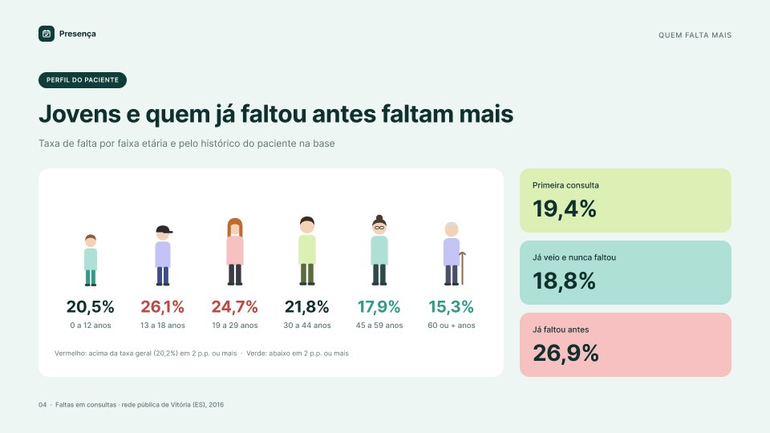](https://www.figma.com/slides/oxiDn0T2xjWyQlVPDGu9he)

🔗 [Ver a apresentação](https://www.figma.com/slides/oxiDn0T2xjWyQlVPDGu9he)

### Documentação do modelo Power BI de faltas · Claude + Python (TMDL)
**Autoral.** Documentação técnica gerada por um script que lê os arquivos do projeto Power BI.
- Arquitetura, diagrama do modelo e dicionário de 46 colunas
- Catálogo das 17 medidas DAX e das colunas calculadas

[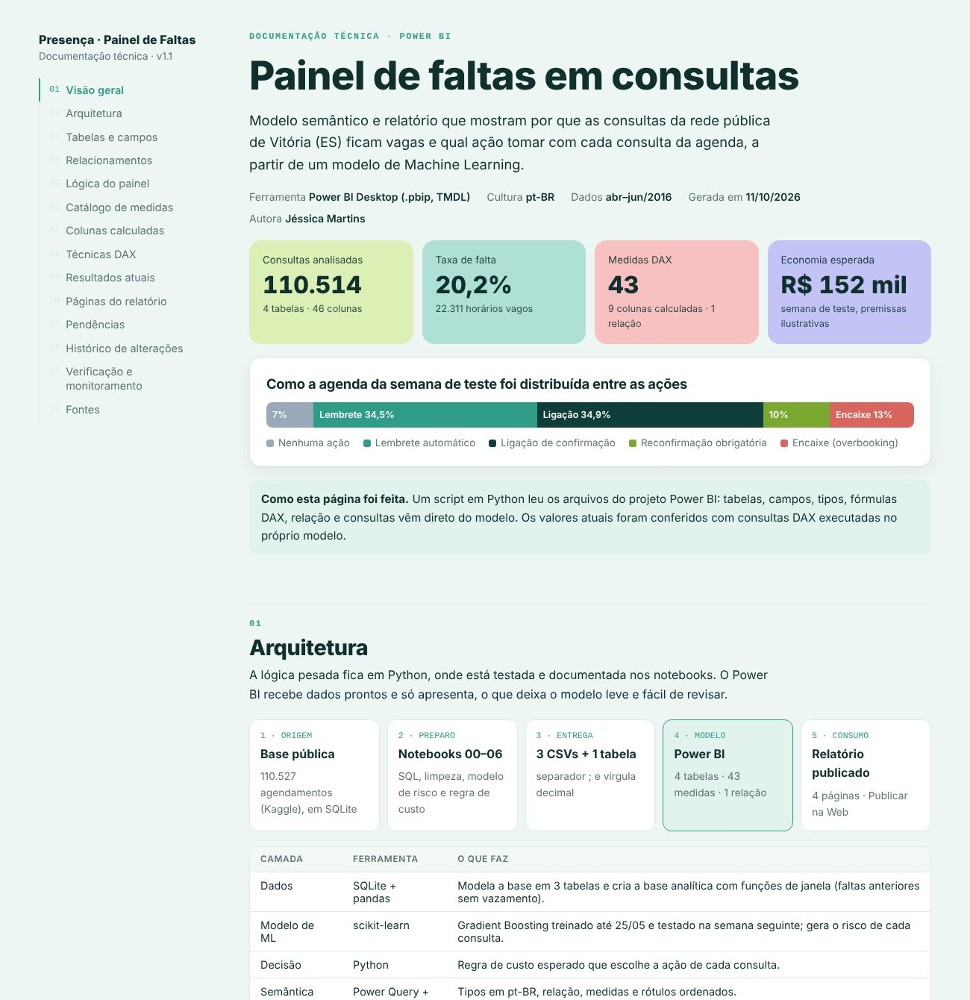](https://claude.ai/artifact/NVBMomumL2gSB1UVCS4ktG)

🔗 [Abrir a documentação](https://claude.ai/artifact/NVBMomumL2gSB1UVCS4ktG) · [ver o script](https://github.com/jessicapmartins/previsao-faltas-consultas/tree/main/docs)

### Fluxo de Caixa 2025 · Claude + Vercel
**Autoral.** Dashboard financeiro publicado na web, a partir de um extrato com 1.200 lançamentos.
- Receitas, despesas, lucro e margem com filtros por período
- Mapa de calor de despesas por categoria e mês
- Auditoria da base, separando evidência de hipótese

[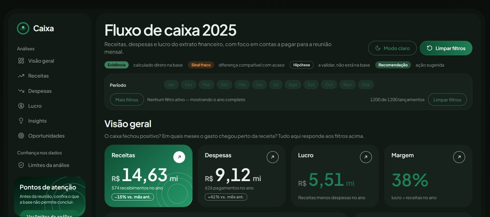](https://fluxo-de-caixa-2025-two.vercel.app/)

🔗 [Abrir o dashboard](https://fluxo-de-caixa-2025-two.vercel.app/)

### RotaViva: painel de logística · Claude + Lovable
*Projeto de workshop.* Painel de entregas com camada de acesso por login, pensado para uso interno de uma operação.
- Entregas no prazo, atrasos, custo de frete e ocorrências
- Visões por transportadora, rota e região
- Destaques automáticos: onde agir primeiro

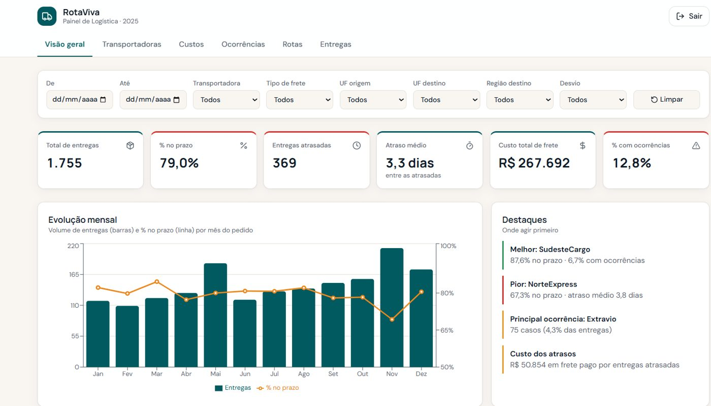

> O acesso exige login. Acesso de demonstração sob pedido.

### Análise de satisfação NPS · Claude + Figma
Apresentação executiva gerada a partir de um dashboard, com a análise transformada em narrativa.
- Sumário executivo com NPS, promotores e detratores
- Destaques por região, gerente e comentários

[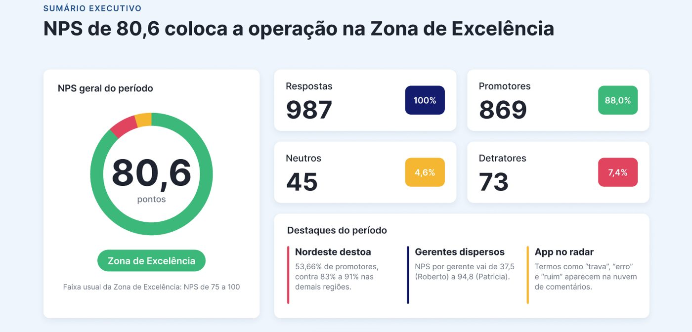](https://www.figma.com/deck/sUV5QB78OCeCFdWgE6lmWP/)

🔗 [Ver a apresentação](https://www.figma.com/deck/sUV5QB78OCeCFdWgE6lmWP/)

### Relatório executivo automatizado · faltas em consultas · Claude (skill personalizada)
**Autoral.** Uma skill que lê qualquer planilha Excel ou CSV e gera um relatório executivo em PDF. Evoluí a skill de fechamento do workshop para funcionar com qualquer tema e apliquei nas bases do painel de faltas (110 mil consultas).
- KPIs, resumo executivo, evolução semanal e ponto de atenção
- Análise por tema com gráficos comparativos, conclusão e próximos passos
- Checagem das projeções da base: a economia prevista pelo modelo foi recalculada com a taxa real de faltas

[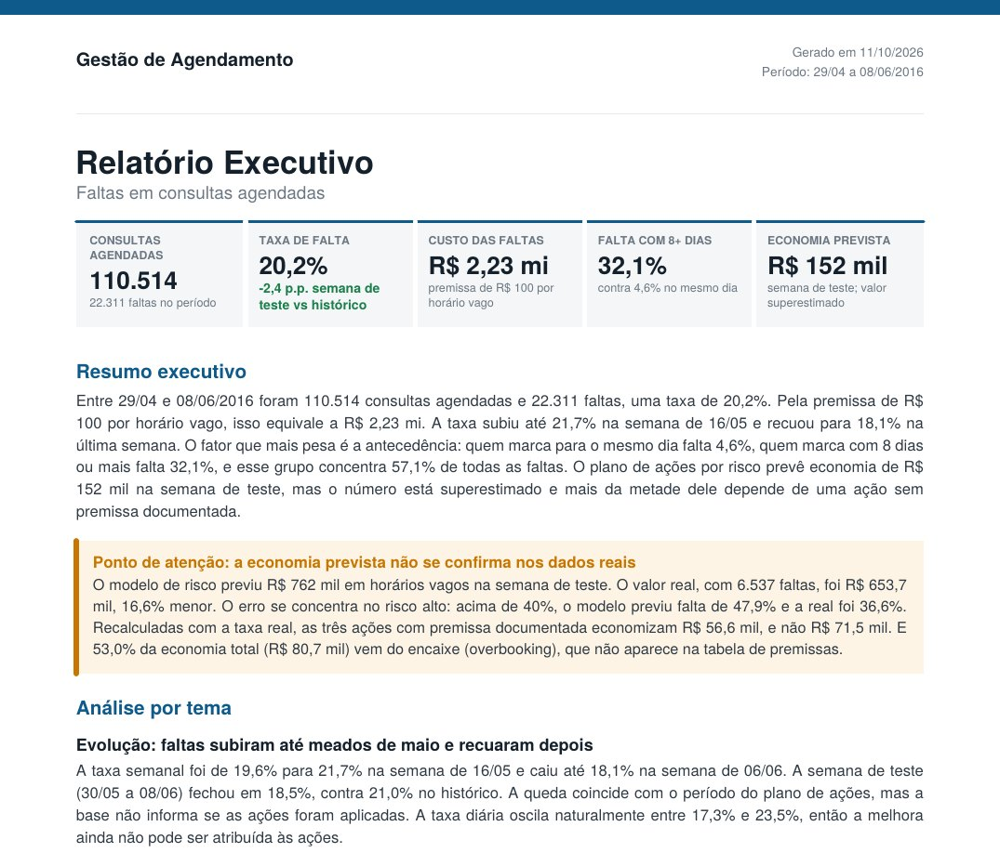](img/relatorio-faltas-consultas.pdf)

🔗 [Abrir o relatório (PDF)](img/relatorio-faltas-consultas.pdf)

---

**Jéssica Priscila de Oliveira Martins** · [LinkedIn](https://www.linkedin.com/in/jessica-oliveira-martins/) · [Portfólio](https://portfolio-jessica-martins.vercel.app/) · [Outros projetos](https://github.com/jessicapmartins)
